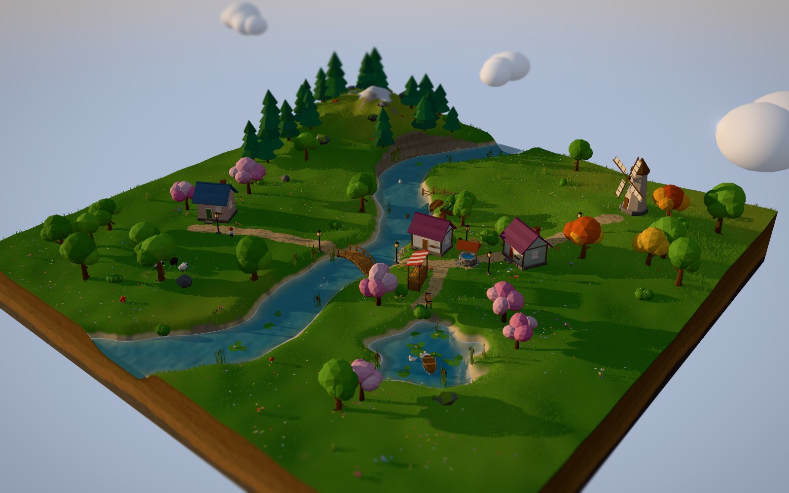
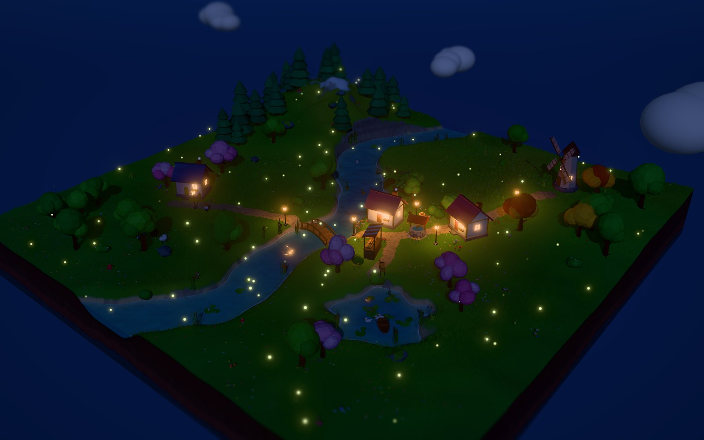

# 🌿 Little Garden

A cozy little garden builder that runs entirely in the browser. You start with a floating island. You can dig rivers and ponds, sculpt hills, paint paths, plant trees and flowers, and build a sleepy village of cottages, a windmill, lanterns and bridges. Ducks, sheep, villagers and butterflies wander around it. Slide the sun down and the windows and lanterns light up while fireflies come out.

Built with [three.js](https://threejs.org) and Vite, with an optional [Blender](https://www.blender.org) pipeline for your own models.




## Run it

```bash
npm install
npm run dev        # http://localhost:5173
```

Other scripts:

| Command | What it does |
| --- | --- |
| `npm run build` | Static site in `dist/`, which you can host anywhere (GitHub Pages, Netlify, itch.io…) |
| `npm run build:single` | One self-contained `dist-single/index.html` with everything inlined |
| `npm run preview` | Serve the production build locally |

## How to play

| | |
| --- | --- |
| **Place things** | Pick an item in the bottom bar and click. Flowers, bushes, lily pads and similar items can be **dragged** to scatter them. Fences draw in **lines**. |
| **Sculpt** | Use the **Land** tab: Raise, Lower, Flatten and Smooth. Use **River** to carve water anywhere and **Fill** to turn it back into land. Hold <kbd>Shift</kbd> to reverse a brush. |
| **Paint** | Paint grass, dirt paths, cobbles, sand and farm soil. **Meadow** sprinkles wildflowers into the grass. |
| **Camera** | Right-drag to orbit, scroll to zoom, middle-drag or <kbd>W</kbd><kbd>A</kbd><kbd>S</kbd><kbd>D</kbd> to pan, <kbd>Q</kbd>/<kbd>E</kbd> to turn. On touch screens, use two fingers or the **Look** tool. |
| **Edit** | Use **Move** to pick something up and drop it somewhere else, and **Remove** to tidy things away. <kbd>R</kbd> rotates, <kbd>[</kbd>/<kbd>]</kbd> change the brush size, <kbd>Ctrl</kbd>+<kbd>Z</kbd> undoes. |
| **Time** | The ☀️ slider sets the time of day. ▶ lets the day pass on its own. |
| **Photo mode** | Press <kbd>P</kbd> to hide the UI and save a picture. |

Your garden autosaves to the browser's local storage. The ☰ menu can export and import it as a `.json` file, start a new island and change the graphics quality.

## How it's made

There are no textures or audio files at all. Everything is generated in code.

```
src/
  main.js                 boot, render loop, camera, keyboard, quality presets
  config.js               world size, water level, paint layers
  world/
    terrain.js            heightfield + brushes (raise, dig, paint…), diorama "dirt block" sides
    water.js              one water sheet; its shader reads terrain depth for colour + shore foam
    grass.js              ~40k instanced grass blades + wildflowers, placed on the GPU
    environment.js        sky dome, sun/moon, day–night palette keyframes, fog
    clouds.js, particles.js   drifting clouds, fireflies/pollen, chimney smoke
  objects/
    builder.js            merges primitives into ONE vertex-coloured geometry per object
    nature.js, village.js, critters.js   every item, built procedurally from a seed
    custom.js             loads your Blender .glb models from models/
    manager.js            placing, removing, pop-in animations, save/load
    agents.js             wander-around-home behaviour for critters
  render/
    post.js               bloom + tilt-shift (the miniature look) + vignette
    glsl.js, patch.js     shared shader snippets, injected into three's standard materials
    lamps.js              pool of warm point lights handed to the nearest lanterns at night
    thumbnails.js         renders the toolbar icons from the real models
  game/
    tools.js              all the brushes and placement tools
    history.js, storage.js, starter.js, audio.js
  ui/                     the cozy DOM toolbar
```

A few techniques do most of the work for the look:

- **A "field" texture.** Terrain height, grass density and wildflower paint live in one float texture. The water reads it to know how deep it is, which drives the shallow/deep colours and foam lines. Grass blades and fireflies read it to know where the ground is. A terrain edit only updates that texture, with no per-blade work on the CPU.
- **Patched built-in materials.** Terrain, water, grass and objects are three.js `MeshStandardMaterial`/`MeshLambertMaterial` with extra GLSL spliced in, so they still get real shadows, fog and lighting.
- **One draw call per object.** Each tree or house is built from primitives and merged into a single vertex-coloured mesh. Extra vertex attributes mark what sways in the wind (`aSway`) and what glows at night (`aGlow`).
- **The diorama look** comes from soft PCF shadows, a hemisphere fill light, Khronos Neutral tone mapping, gentle bloom and a tilt-shift blur.

## Bringing in your own Blender models

Any `.glb` dropped into the top-level **`models/`** folder appears in the game's Village tab automatically, with its own toolbar icon. The included mushroom house was made this way by [`blender/mushroom_house.py`](blender/mushroom_house.py), a Blender script that builds the model and exports it:

```bash
blender --background --python blender/mushroom_house.py
# or open it in Blender's Scripting tab and press Run Script
```

To make your own:

1. **Model at real scale.** 1 Blender unit is 1 metre, so a cottage is about 2.5 m tall. Put the base on the ground (z = 0) with the front facing **-Y**, which is Blender's front view.
2. **Use plain material colours.** Set the Principled BSDF **Base Color**, or use vertex colours. Textures are ignored, and only the base colour is used. This keeps everything in the same flat-shaded, low-poly style.
3. **Name things for special effects:**
   - A material with **Emission**, or with "glow" in its name, lights up at night, for example windows and lamps.
   - A material named **Leaves**, **Foliage**, **Grass** or **Sway** moves in the wind.
4. **Export** with *File → Export → glTF 2.0*. Choose format **glTF Binary (.glb)**, tick **Apply Modifiers**, and keep **+Y Up** on. Save it into `models/`.
5. **Tune it (optional).** Add an entry to `MODEL_OPTIONS` in [`src/objects/custom.js`](src/objects/custom.js) to set its name, tab, footprint, whether it flattens the ground, whether it emits light at night, and so on:

```js
'my_windmill.glb': { name: 'Big Windmill', cat: 'village', radius: 1.4, solid: true, flatten: 1.3, rotStep: Math.PI / 4 },
```

## Adding procedural items

Every built-in item is a small function in `src/objects/nature.js`, `village.js` or `critters.js`. Here's a complete one:

```js
{
  id: 'stump',
  name: 'Tree Stump',
  cat: 'nature',
  radius: 0.35,
  scale: [0.8, 1.2],
  build(rng) {
    const B = new Builder(rng);
    B.cyl(0.28, 0.34, 0.3, 9, '#7a5236', { p: [0, 0.15, 0] });
    B.cyl(0.27, 0.27, 0.02, 9, '#d9b98a', { p: [0, 0.31, 0] }); // rings on top
    if (rng.chance(0.5)) B.ico(0.06, 0, '#d9443a', { p: [0.2, 0.33, 0.1] }); // a tiny mushroom
    return B.build();
  },
},
```

`rng` is seeded per placed object, so the same seed always rebuilds the same model. That's how saves stay small.

## Deploying

`npm run build` outputs a static site to `dist/`. The included GitHub Actions workflow (`.github/workflows/deploy.yml`) publishes it to GitHub Pages on every push to `main`. Turn it on once under **Settings → Pages → Source: GitHub Actions**.

## Ideas for what's next

- Waterfalls and water at more than one height
- Seasons (snow, autumn leaves, spring blossoms) and weather (rain, fog)
- More critters (cats, chickens, foxes) and villagers who walk the paths and go home at night
- Sharing a garden through a link
- Ambient music
